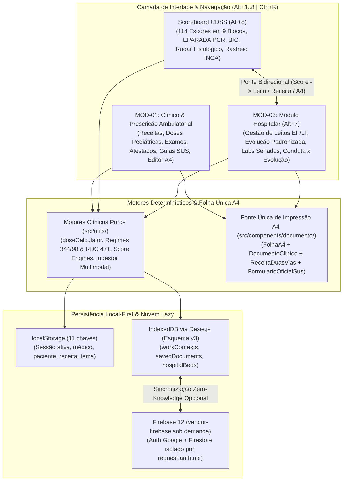

# PresCMed (`PCM`) — Plataforma Clínica, Prescrição Ambulatorial, Escores CDSS e Gestão Hospitalar

[-0ea5e9?style=flat-square&logo=googlecloud)](https://prescmed-syqnqsm4iq-rj.a.run.app)
[](https://react.dev/)
[](https://www.typescriptlang.org/)
[](https://tailwindcss.com/)
[](https://dexie.org/)
[](https://vitest.dev/)
[](#7-testes-e-portões-de-qualidade-26-suítes--241-testes)
[](https://web.dev/progressive-web-apps/)

Plataforma médica digital *offline-first* para o contexto clínico, ambulatorial, de emergência e hospitalar brasileiro (`pt-BR`): receituário inteligente no padrão PEC/SUS, calculadora pediátrica por peso, central de documentos (atestados CFM, encaminhamentos, exames e 9 formulários regulatórios do SUS), bancada de apoio à decisão clínica (**Scoreboard CDSS** com **114 escores**, painel **EPARADA** ACLS/PALS, **Bomba de Infusão Contínua** e **Rastreio Oncológico INCA/MS**) e **Módulo Hospitalar (`MOD-03`)** com gestão de leitos, evolução padronizada, ingestão multimodal sem alucinação e painel longitudinal *Conduta × Evolução*.

**Produção:** [https://prescmed-syqnqsm4iq-rj.a.run.app](https://prescmed-syqnqsm4iq-rj.a.run.app)

> [!IMPORTANT]
> Quem for alterar o código (pessoa ou agente) deve ler o [`AGENTS.md`](AGENTS.md) e a especificação detalhada [`docs/CLINICAL_AND_RUNTIME_SPEC.md`](docs/CLINICAL_AND_RUNTIME_SPEC.md): eles documentam as invariantes clínicas, sanitárias (Portaria SVS/MS nº 344/98, RDC Anvisa nº 471/2021, Resoluções CFM nº 1.658/2002 e 1.819/2007) e de emissão em folha A4 única.

---

## 1. Arquitetura: Local-First, Multi-Módulo e Nuvem Opcional

O PresCMed é uma **SPA 100% client-side**, projetada para pronto-socorro, UBS, ambulatório, enfermaria e UTI, operando integralmente mesmo com internet instável ou ausente.



* **Funciona offline (PWA):** todo o processamento ocorre no navegador. O Service Worker (`vite-plugin-pwa` / Workbox) armazena os assets estáticos e o catálogo offline de formulários SUS (`public/formularios-sus-offline.html`).
* **Persistência em duas camadas locais:**
  * `localStorage` (`src/services/storageService.ts`): 11 chaves oficiais para a consulta ativa (médico, paciente, itens da receita, exames, atestado, encaminhamento, tema e preferências).
  * `IndexedDB` (`src/services/db.ts` — **Dexie.js esquema v3** + `src/core/storage/clinicalRepository.ts`): tabelas `workContexts` (postos de trabalho municipal/estadual/federal/privado), `savedDocuments` (modelos e documentos do Editor A4) e `hospitalBeds` (leitos hospitalares, exames seriados, escores longitudinais e snapshots de evolução).
* **Nuvem opcional e sob demanda (Firebase 12):** o SDK fica isolado no chunk `vendor-firebase`, carregado somente após ação explícita do médico no botão de nuvem (`src/services/cloud/`). Sincroniza postos de trabalho e modelos reutilizáveis no Firestore sob isolamento estrito por `request.auth.uid` (`firestore.rules`), sem trafegar dados sensíveis de pacientes.
* **Zero telemetria oculta:** nenhum dado clínico é enviado a servidores externos sem ação explícita do usuário.

---

## 2. Macro-Módulos e Funcionalidades Principais

### 2.1. Módulo Clínico & Prescrição Ambulatorial (`MOD-01` — `Alt+1` a `Alt+6`)

* **Receita Médica em A4 Paisagem — Padrão PEC do SUS (`Alt+1`)**
  * Combobox único de busca fonética/aproximada (`Ctrl+K` / `src/utils/fuzzySearch.ts`) com priorização de monofármacos sobre associações, modo rápido de posologia (cálculo automático do total de comprimidos/frascos), **6 kits clínicos de plantão** e **8 protocolos por patologia**.
  * **Três regimes sanitários automáticos** em folha A4 horizontal (`1123×794 px`), separados por documento:
    * **Simples:** 1 via na metade esquerda da folha, linha de corte central e metade direita livre.
    * **Antimicrobiano (RDC Anvisa nº 471/2021):** 2 vias lado a lado, validade de 10 dias (retenção da **2ª via** na farmácia e 1ª via do paciente), incluindo sexo do paciente quando informado.
    * **Controle Especial (Portaria SVS/MS nº 344/98):** 2 vias lado a lado (retenção da **1ª via** na farmácia e 2ª via do paciente), com endereço do paciente e quadros de comprador e fornecedor.
  * **Aviso de Talonário Próprio (`.no-print`):** alerta na tela e no texto exportado (WhatsApp/área de transferência) quando o fármaco exige **Notificação de Receita** física (listas `A1`, `A2` > 100 mg de codeína/tramadol, `A3`, `B1`, `B2`, `C2` retinoides e `C3` talidomida/lenalidomida), sem poluir a folha A4 impressa.
* **Central de Documentos (`Alt+2`) e Guias SUS (`Alt+6`)**
  * **Atestado Médico:** o código CID-10 só é impresso mediante consentimento explícito do paciente (`authorizedByPatient === true`, Resoluções CFM nº 1.658/2002 e 1.819/2007).
  * **Encaminhamento:** especialidade de destino, prioridade (`eletivo`, `prioritario`, `urgente`), resumo clínico e hipótese diagnóstica.
  * **Pedido de Exames:** catálogo laboratorial e de imagem com **14 rotinas clínicas prontas** (pré-natal por trimestre, saúde da mulher/homem/idoso, HAS, DM, IST, pré-operatório, etc.), com ações diretas para **Visualizar Folha A4 e Emitir PDF**, **Abrir no Editor A4** (`buildExamRequestHtmlForA4`) e **Copiar Pedido** em texto estruturado.
  * **9 Documentos Regulatórios do SUS (`Alt+6`):**
    * **APAC Principal (55 campos)** e **LME (23 campos)** saem sobre a imagem do **impresso oficial do Ministério da Saúde** (`public/formularios-sus/`), posicionando cada dado exatamente no campo numerado (incluindo CNS, CPF e CNES do médico) ou permitindo edição na **grade vetorial interativa de 12 colunas (`SusInteractiveVectorSheet.tsx` / `.sus-grid`)**.
    * **7 Guias Complementares** (`APAC Complementar`, `SISREG`, `SISCAN Citopatológico`, `SISCAN Histopatológico`, `SISCAN Mamografia`, `GAL/LACEN Geral` e `GAL TRM-TB`) saem em grades técnicas HTML numeradas com timbre duplo (`TimbreSus`: logo institucional à esquerda + logo SUS à direita) e zero dados clínicos presumidos.
* **Calculadora Pediátrica por Peso (`Alt+3` e Gaveta Lateral)**
  * Converte `mg/kg` em `mL` ou `gotas` com trava de segurança **"Sem peso, sem dose"** (faixa aceita: `0,5 kg` a `120 kg`) e tetos máximos por tomada (ex.: trava de `20 mL` para amoxicilina `250 mg/5 mL` e prednisolona `3 mg/mL`).
* **Protocolos Clínicos (`Alt+4`) e Editor A4 Rico (`Alt+5`)**
  * Busca rápida textual por patologia, conduta ou medicamento (`#protocol-search-input`) integrada à Command Palette (`Ctrl+K`) e filtros por especialidade.
  * Editor rico baseado em **Tiptap 3** com alternância entre 1 via (A4 retrato) e 2 vias (A4 paisagem: Simples, Antimicrobiano e Controle Especial), gerador de logotipos/monogramas vetoriais SVG (`LogoGeneratorModal.tsx`), marcas d'água e engenharia reversa do HTML de volta para itens estruturados da receita (`parsePrescriptionHtml.ts`).

### 2.2. Módulo Hospitalar & Gestão de Pacientes (`MOD-03` — `Alt+7`)

* **Gestão de Enfermaria e Leitos (`EF/LT`):** cadastro e alternância rápida de leitos com templates adaptados por especialidade (`enfermaria_clinica`, `uti`, `pediatria`, `ortopedia`, `gineco_obstetricia`, `cirurgia_geral`) e cálculo automático de idade e dias de internação (`DIH` → `D1..Dn`).
* **Modelo Padronizado de Evolução e Admissão:** geração determinística de texto clínico e folha A4 estruturada com `EF/LT`, `ID`, `DN`, `CNS`, `DIH`, `QP`, `HD` em árvore (`1` e `1.1` com datas), `HDA` cronológica, `ALERGIAS`, `SOROLOGIAS`, `HPP`, `HF/SOCIAL`, `HISTÓRIA OBSTÉTRICA`, `FEZ USO`, `EM USO`, `EXAMES LAB` em linha compacta, `EXAMES DE IMAGEM`, `ESCORES CLÍNICOS`, `EXAME FÍSICO` (categorias fixas + seções livres por especialidade), `EVOLUÇÃO 24H`, `DIETA`, `HIDRATAÇÃO`, `Pareceres`, `PENDÊNCIAS` e `CD`.
* **Ingestão Multimodal sob Diretriz de Rigor Terapêutico:** importação assistida de prontuários (`.pdf`, `.doc`, `.docx`, fotos, texto colado e ditado por voz) com **zero dados inventados**, rastreabilidade literal e ordenação estritamente cronológica.
* **Monitoramento Longitudinal & Dashboard *Conduta × Evolução*:** tabelas e curvas SVG seriadas (`tabular-nums`) para marcadores laboratoriais, sinais vitais e **escores clínicos CDSS**, cruzando automaticamente 6 eixos terapêuticos (`infeccioso`, `hemodinamico`, `renal`, `ventilatorio`, `metabolico`, `escores_clinicos`) com o parecer de resposta clínica (`favorable`, `attention`, `alert`).
* **Copiloto do Leito & Agente Science:** assistente contextual por leito (incluindo análise de tendência dos escores seriados) e consulta rápida de protocolos baseados em evidências.

### 2.3. Scoreboard CDSS & Ferramentas de Apoio Clínico (`Alt+8`)

* **Catálogo Monográfico de 114 Calculadoras em 9 Blocos de Especialidade:**
  1. `block_01` — Emergência & UTI (`SOFA`, `qSOFA`, `APACHE II`, `SAPS 3`, `NEWS2`, `MEWS`, `ROX Index`, etc.)
  2. `block_02` — Cardiologia & TEP (`CHA₂DS₂-VASc`, `HAS-BLED`, `HEART`, `TIMI`, `GRACE`, `Wells TEP/TVP`, `PESI`, etc.)
  3. `block_03` — Neurologia & Coluna (`Glasgow-P`, `NIHSS`, `ABCD²`, `Hunt & Hess`, `Fisher`, `FOUR`, `ASIA`, `TLICS`, `SLIC`, `Oswestry`, etc.)
  4. `block_04` — Pneumologia & Ventilação Mecânica (`CURB-65`, `PSI/PORT`, `SMART-COP`, `BODE`, `Peso Predito ARDSNet`, `Driving Pressure`, `P/F Ratio`, etc.)
  5. `block_05` — Nefrologia & Ácido-Base (`CKD-EPI 2021`, `Cockcroft-Gault`, `Schwartz`, `FENa`, `FEUreia`, `Ânion Gap`, `Fórmula de Winter`, `Déficit de Água Livre`, `Adrogué-Madias`, etc.)
  6. `block_06` — Gastroenterologia & Hepatologia (`Child-Pugh`, `MELD-Na`, `Maddrey`, `Lille`, `Glasgow-Blatchford`, `Rockall`, `BISAP`, `Ranson`, `Alvarado`, etc.)
  7. `block_07` — Trauma & Choque (`ISS`, `RTS`, `TRISS`, `Shock Index`, `ABC Score`, `Parkland`, `NEXUS`, `Canadian C-Spine`, `PECARN`, etc.)
  8. `block_08` — Infectologia & Perioperatório (`Lee RCRI`, `Caprini`, `Padua`, `ASA`, `Goldman`, `Centor/McIsaac`, `MASCC`, `Pitt Bacteremia`, etc.)
  9. `block_09` — Pediatria, GO & Toxicologia (`Apgar`, `Silverman-Anderson`, `Westley Croup`, `PAS`, `PEWS`, `Bishop`, ` Rumack-Matthew`, `Osmolal Gap`, etc.)
* **Bomba de Infusão Contínua (`ScoreBicInfusionCard.tsx`):** cálculo reverso e direto (`mcg/kg/min` $\leftrightarrow$ `mL/h`) para drogas vasoativas e sedoanalgesia com envio em 1 clique para a Receita.
* **Radar Fisiológico (`ScorePhysiologicalRadar.tsx`) & Exportação PEP (`pepExportEngine.ts`):** síntese visual multissistêmica e geração de blocos SOAP/SBAR prontos para o Editor A4.
* **Painel `EPARADA` (PCR ACLS / PALS) & Rastreio Oncológico INCA/MS (`EparadaAndScreeningPanel.tsx`):**
  * Cronômetro de ciclo de RCP (`2:00`), doses de emergência guiadas por peso (com trava *"Sem peso, sem dose"*), energia de desfibrilação em Joules e checklist reversível **5H / 5T**.
  * Rastreio oncológico rápido para **Mama (BI-RADS)**, **Colo do Útero (Citopatológico)** e **Próstata (PSA)** com adição automática do exame SIGTAP/SUS ao pedido ativo.
* **Ponte Bidirecional com Internação (`MOD-03`):** qualquer escore calculado no `Scoreboard CDSS` pode ser registrado diretamente no leito ativo (`HospitalBedScoreEntry`), alimentando a curva longitudinal e o cruzamento *Conduta × Evolução* no Dashboard Hospitalar, com botão de retorno em 1 clique (**`Voltar ao Leito`**) para a evolução do paciente internado.

---

## 3. Stack Tecnológica

| Camada | Tecnologias |
| :--- | :--- |
| **Interface & Estilo** | React 19 (`19.0.1`), TypeScript `~5.8.2`, Tailwind CSS v4 (`@tailwindcss/vite`) e Material Symbols (offline via `<Icon />`) |
| **Build & Bundler** | Vite 6 (`6.2.3`) com code-splitting manual (`vendor-react`, `vendor-tiptap`, `vendor-dexie`, `vendor-firebase`, `scores-catalog`) |
| **Editor Rich-Text A4** | Tiptap 3 (`@tiptap/react`, `starter-kit`, `extension-text-align`, `extension-placeholder`) |
| **Persistência Local** | Dexie.js 4 (`4.4.6` — IndexedDB v3: `workContexts`, `savedDocuments`, `hospitalBeds`) + `localStorage` |
| **Motor de PDF** | `html2canvas-pro` (`2.4.5`, suporte nativo a `oklch()`) + `jsPDF` (`4.2.1`) |
| **PWA / Offline** | `vite-plugin-pwa` (`1.3.0` / Workbox `generateSW`) |
| **Nuvem Opcional** | Firebase 12 (`12.19.0` — Google Auth + Cloud Firestore sob demanda) |
| **Qualidade & Testes** | Vitest 5 (`5.0.2` — 26 suítes, 241 testes determinísticos Nível 4) + `@google/design.md` |
| **Produção** | Google Cloud Run (`southamerica-east1`), container multi-stage (`node:24-alpine` + `nginx:alpine`) |

---

## 4. Estrutura Completa do Repositório (`170` arquivos em `src/`)

```plaintext
PCM/
├── AGENTS.md                        # Governança, comandos e invariantes clínicas/sanitárias (leitura obrigatória)
├── GEMINI.md / CLAUDE.md            # Instruções de contexto para assistentes de IA
├── CONTEXT.md                       # Estado operacional e resumo arquitetural
├── SPEC.md                          # Contratos técnicos e invariantes YMYL
├── DESIGN.md                        # Sistema de Design v5.0 (validado por `npm run design:lint`)
├── Dockerfile                       # Multi-stage: lint + test + build (node:24-alpine) -> runtime (nginx:alpine)
├── cloudbuild.yaml                  # Pipeline CI/CD Cloud Build (build, push, deploy e smoke test em /health)
├── nginx.conf                       # Porta $PORT, SPA fallback, compressão gzip, cache e endpoint /health
├── nginx-security-headers.conf      # CSP ativa, HSTS, X-Frame-Options, X-Content-Type-Options e Referrer-Policy
├── firestore.rules                  # Isolamento estrito por request.auth.uid no Cloud Firestore
├── deploy-cloudrun.ps1 / .sh        # Scripts para disparo manual do Cloud Build a partir da máquina local
├── .context/                        # Estado evolutivo (.context/CURRENT_STATE.md e logs de sessão)
├── .github/                         # Agente revisor clínico e skills locais (clinical-change-safety, ui-pdf-validation)
├── docs/
│   ├── CLINICAL_AND_RUNTIME_SPEC.md # Especificação detalhada de runtime, árvore completa e regras SUS/CFM/Anvisa
│   ├── historico/                   # Relatórios de auditoria, estabilização e roadmaps
│   └── superpowers/specs/           # Especificações de resiliência do Editor A4
├── public/
│   ├── formularios-sus/             # Fundos oficiais do Ministério da Saúde (apac-laudo.png, lme.png)
│   ├── formularios-sus-offline.html # Catálogo HTML standalone para consulta/impressão offline de guias SUS
│   ├── logos/                       # Brasões e logos institucionais (sus.png, semusa.png, sesau-ro.png, rondonia-brasao.svg)
│   └── watermarks/                  # Marcas d'água institucionais e PDFs base
└── src/                             # 170 arquivos de código-fonte e testes
    ├── main.tsx                     # Bootstrap React 19 (StrictMode)
    ├── App.tsx                      # Orquestrador de estado global, modais, leitos hospitalares e navegação por abas
    ├── types.ts                     # Contratos globais (DoctorProfile, Patient, PrescriptionItem, ActiveTab, SUS, etc.)
    ├── types/index.ts               # Estados finitos de UI (UIState) e reexportações
    ├── config/tokens.ts             # Registro canônico de tokens semânticos e densidade
    ├── styles/globals.css           # Tokens CSS (:root), escala fluida clamp(), .clinical-unit e curvas de transição
    ├── index.css                    # Tailwind CSS v4 (@layer components e @utility)
    ├── core/
    │   ├── domain/                  # clinicalEntities.ts (MOD-01..03, HospitalBedPatientRecord, HospitalBedScoreEntry, SOAP)
    │   └── storage/                 # clinicalRepository.ts (IClinicalRepository / LocalDexieClinicalRepository)
    ├── components/
    │   ├── Header.tsx               # Cabeçalho com barra segmentada de módulos (Alt+1..8), busca Ctrl+K, perfil e nuvem
    │   ├── Sidebar.tsx              # Navegação lateral em Deep Navy (recolhível 68px), posto SUS, macro-módulos e kits
    │   ├── MobileBottomNav.tsx      # Navegação inferior mobile com 5 destinos principais
    │   ├── PrescriptionBuilder.tsx  # Orquestrador da tela de receitas e gaveta pediátrica
    │   ├── prescription/            # Subcomponentes: PatientQuickCard, MedicationComposerCard, PrescribedItemsList,
    │   │                            # PrescriptionModelsModal e PrescriptionPreviewColumn
    │   ├── AcoesDaReceita.tsx       # Barra de ações da receita (Imprimir/PDF, Editor, WhatsApp, Copiar)
    │   ├── AvisoNotificacaoReceita.tsx # Alerta .no-print para listas A1, A2 (>100mg), A3, B1, B2, C2 e C3
    │   ├── PediatricCalculator.tsx  # Calculadora pediátrica por peso (mg/kg -> mL/gotas)
    │   ├── ClinicalDocumentsHub.tsx # Central de Documentos (Atestado, Encaminhamento, Exames e SUS)
    │   ├── CertificateAndReferral.tsx # Atestados médicos (consentimento CID-10 CFM) e encaminhamentos
    │   ├── ExamRequester.tsx        # Solicitação de exames laboratoriais/imagem e 14 rotinas clínicas
    │   ├── SusDocumentsFiller.tsx   # Orquestrador de preenchimento e emissão dos 9 documentos SUS
    │   ├── sus/                     # SusCatalogListView, SusCommonIdentityFields, SusRegulatorySpecificFields
    │   │                            # e SusInteractiveVectorSheet (grade vetorial .sus-grid de 12 colunas)
    │   ├── ClinicalProtocolsView.tsx # Protocolos clínicos e consulta por classes SUS/RENAME
    │   ├── DocumentEditorView.tsx   # Orquestrador do Editor A4 rico (Tiptap 3)
    │   ├── editor/                  # 7 módulos: editorConfigAndFormatters, EditorTopActionsBar, EditorSheetConfigBar,
    │   │                            # EditorTextFormattingToolbar, EditorSingleViaCanvas, EditorTwoViasCanvas, EditorModelsAndStylesDrawer
    │   ├── hospital/                # Módulo Hospitalar (MOD-03): HospitalWardModuleView, HospitalEvolutionFormPanel,
    │   │                            # HospitalLabsAndAnalyticsPanel, HospitalBedChatAndSciencePanel, HospitalMultimodalImportModal
    │   ├── scores/                  # Scoreboard CDSS: ScoreboardModuleView, ScoreCalculatorDetailView, EparadaAndScreeningPanel,
    │   │                            # ScoreBicInfusionCard, ScoreParameterGroupInput, ScorePhysiologicalRadar
    │   ├── documento/               # Folha A4 única: FolhaA4, DocumentoClinico, ReceitaDuasVias,
    │   │                            # FormularioOficialSus, CabecalhoInstitucional, AssinaturaMedico
    │   ├── bento/                   # ConsultationReadinessBar (prontidão de emitente, paciente/peso e conduta)
    │   ├── layout/                  # CommandPaletteModal (busca global Ctrl+K de fármacos, kits, protocolos, SUS e 114 escores)
    │   ├── logo/                    # LogoSvgCanvas (renderizador SVG vetorial para brasões e monogramas)
    │   ├── ui/                      # Primitivas táteis: SurfaceCard, SoftCard, ActionButton, Badge
    │   └── [Modais e Utilitários]   # PatientModal, DoctorProfileModal, BackupModal, CidSearchBar, ConfirmationModal,
    │                                # ContextSwitcher, LogoGeneratorModal, PrintPreview, PuxarParaAtualizar,
    │                                # WatermarkOverlay, WatermarkSelector, AsyncErrorBoundary, Icon
    ├── data/
    │   ├── medications/             # Base farmacológica dividida em 4 domínios (analgésicos/AINEs, antimicrobianos,
    │   │                            # cardio/metabólicos, respiratórios/gastro/SNC) + barrel medicationDatabase.ts
    │   ├── scores/                  # scoreboardCatalog.ts, manifest.json (114 calculadoras) e blocks/block_01..09.json
    │   ├── pediatricMeds.ts         # Fármacos pediátricos com faixas mg/kg e tetos de segurança
    │   ├── clinicalKits.ts          # 6 kits ambulatoriais de plantão
    │   ├── clinicalProtocols.ts     # 8 protocolos patológicos e cálculo de hidratação/emergência
    │   ├── examCatalog.ts           # Catálogo de exames e 14 painéis de rotina
    │   ├── cidCatalog.ts            # Base CID-10 com sinônimos de busca
    │   ├── susDocumentsCatalog.ts   # Catálogo dos 9 documentos SUS, TimbreSus e gerador de grades técnicas HTML
    │   ├── formulariosOficiaisSus.ts # Coordenadas milimétricas dos campos numerados da APAC (55) e LME (23)
    │   └── [Presets e Configs]      # exemplos.ts, externalUrlsConfig.ts, presetAssets.ts, presetClinicalTemplates.ts
    ├── hooks/                       # 8 hooks: usePrescriptionSession, usePrescriptionModels, useWorkContext,
    │                                # useDocumentLogoManager, useDocumentTemplatesAndStyles, useNavigationSync,
    │                                # useModalAccessibility, usePwaInstall
    ├── services/                    # db.ts (Dexie v3), storageService.ts, backupService.ts (.pcm.json) e
    │                                # cloud/ (firebaseClient.ts, cloudAuthService.ts, cloudSyncManager.ts)
    ├── utils/
    │   ├── hospital/                # hospitalEvolutionFormatter.ts, hospitalMultimodalIngestor.ts, hospitalAiAssistantService.ts
    │   ├── scores/                  # calculationEngine.ts, clinicalSpecialtyScores.ts, neuroSpineEngine.ts,
    │   │                            # eparadaAndScreeningEngine.ts, infusionEngine.ts, radarEngine.ts, pepExportEngine.ts, scoreTypes.ts
    │   └── [Motores Clínicos e A4]  # doseCalculator.ts, isSpecialControlOrAntibiotic.ts, notificacaoDeReceita.ts,
    │                                # documentoClinico.ts, folhaA4.ts, renderSheetToPdf.ts, downloadPdf.ts,
    │                                # formularioOficial.ts, prescricaoRapida.ts, montarItensDoKit.ts, fuzzySearch.ts,
    │                                # parsePrescriptionHtml.ts, sanitizeHtml.ts, compartilhamentoTexto.ts, medicoConfigurado.ts
    └── __tests__/                   # 26 suítes Vitest (241 testes determinísticos) + snapshots de kits clínicos
```

---

## 5. Atalhos Globais de Produtividade

| Atalho | Destino / Ação |
| :--- | :--- |
| `Ctrl+K` / `Cmd+K` | Abre a **Command Palette Global** (busca unificada de medicamentos, kits, protocolos patológicos e de urgência, leitos hospitalares `MOD-03`, guias SUS e 114 calculadoras CDSS) |
| `Alt+1` | **Receitas** (`PrescriptionBuilder`) |
| `Alt+2` | **Central de Documentos** (`ClinicalDocumentsHub`: Atestado, Encaminhamento, Exames, SUS) |
| `Alt+3` | **Calculadora Pediátrica por Peso** (`PediatricCalculator`) |
| `Alt+4` | **Protocolos Clínicos & RENAME** (`ClinicalProtocolsView`) |
| `Alt+5` | **Editor A4 Rico** (`DocumentEditorView`) |
| `Alt+6` | **Guias Oficiais do SUS** (`SusDocumentsFiller`) |
| `Alt+7` | **Módulo Hospitalar & Gestão de Leitos (`MOD-03`)** (`HospitalWardModuleView`) |
| `Alt+8` | **Scoreboard CDSS, EPARADA & Rastreio Oncológico** (`ScoreboardModuleView`) |

---

## 6. Como Executar Localmente

### Pré-requisitos
* **Node.js 24+** (a imagem de produção utiliza `node:24-alpine`)
* **npm**
* **Git**

### Instalação e Execução

```powershell
git clone https://github.com/melkidonadonmed-lgtm/PCM.git
cd PCM

# Instalação reproduzível a partir do package-lock.json
npm ci

# Servidor de desenvolvimento Vite (porta 3001, host 0.0.0.0)
npm run dev
```

Acesse `http://localhost:3001` no navegador.
O login na nuvem é opcional; as variáveis `VITE_FIREBASE_*` estão documentadas em [`.env.example`](.env.example).

---

## 7. Testes e Portões de Qualidade (`26` suítes / `241` testes)

```powershell
npm run lint         # Type-check estrito: tsc --noEmit (0 any)
npm run test         # Suíte completa Vitest (26 suítes, 241 testes)
npm run test:watch   # Modo interativo contínuo
npm run design:lint  # Conformidade estrutural com o DESIGN.md
npm run build        # Build de produção otimizado em dist/
```

A suíte automatizada (`src/__tests__/`) valida:
* **Segurança Pediátrica e Posologia:** cálculo por peso (`"sem peso, sem dose"`), tetos máximos de volume (`20 mL`), formatação numérica (`"7,5 mg"`, `"1000 mg"` sem separador de milhar) e snapshots dos kits de plantão.
* **Conformidade Sanitária (Anvisa / Portaria 344/98 / RDC 471/2021):** classificação determinística dos 3 regimes em A4 paisagem, retenção de 1ª/2ª via, listas `A1`, `A2` (> 100 mg), `A3`, `B1`, `B2`, `C2` e `C3` com alerta `.no-print`.
* **Sigilo Médico (CFM) e Folha Única A4:** bloqueio de CID-10 sem autorização explícita do paciente, ausência de textos clínicos ou selos inventados, sanitização anti-XSS (`sanitizeHtml.ts`) e conversão reversa de HTML do Editor A4.
* **Guias Oficiais do SUS:** sobreposição exata nos campos numerados da APAC (55 campos) e LME (23 campos), grade vetorial `.sus-grid` e zero dados presumidos nas 9 guias.
* **Módulo Hospitalar (`MOD-03`) e Scoreboard CDSS:** cálculo dos 114 escores clínicos, painel `EPARADA`, rastreio oncológico INCA/MS, ingestão multimodal sem alucinação, curvas longitudinais de escores (`SOFA`, `CURB-65`, `Glasgow-P`) e cruzamento *Conduta × Evolução* no Dashboard Hospitalar.

---

## 8. Deploy em Produção (Google Cloud Run)

O serviço é publicado automaticamente no **Google Cloud Run** (`prescmed`, região `southamerica-east1` — São Paulo) a cada push na branch `main` por meio do gatilho Cloud Build ([`cloudbuild.yaml`](cloudbuild.yaml)).

* **Portão de Qualidade no Build:** o [`Dockerfile`](Dockerfile) executa `npm run lint` e `npm run test` durante o estágio de build. Qualquer falha interrompe a geração da imagem.
* **Deploy Manual:**
  ```powershell
  # Windows (PowerShell 7)
  pwsh -File .\deploy-cloudrun.ps1

  # Linux / macOS / Cloud Shell
  bash deploy-cloudrun.sh
  ```
* **Healthcheck e Segurança:** endpoint `/health` no Nginx ([`nginx.conf`](nginx.conf)) e cabeçalhos de segurança estritos com `Content-Security-Policy` ativa ([`nginx-security-headers.conf`](nginx-security-headers.conf)).

---

## 9. Responsabilidade Clínica

Este software é um instrumento de produtividade e de apoio à decisão médica (*Clinical Decision Support System*). Os cálculos de doses, escores clínicos e emissão de documentos seguem referências médicas e normas sanitárias brasileiras, mas a conduta terapêutica, a prescrição e a conferência final dos dados são de **responsabilidade técnica e legal exclusiva do médico assistente habilitado no CRM**.
