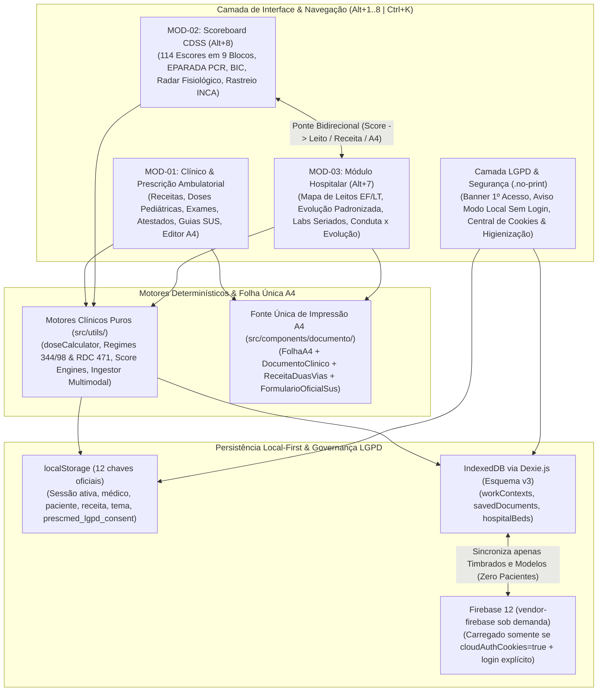

# PresCMed (`PCM`) — Plataforma Clínica Local-First, Prescrição Ambulatorial, Escores CDSS e Gestão Hospitalar

[-0ea5e9?style=flat-square&logo=googlecloud)](https://precmed.web.app)
[](https://react.dev/)
[](https://www.typescriptlang.org/)
[](https://tailwindcss.com/)
[](https://dexie.org/)
[-22c55e?style=flat-square&logo=vitest)](#8-testes-automatizados-e-portões-de-qualidade-27-suítes--254-testes)
[](#3-segurança-seleção-de-cookies-e-conformidade-regulatória-lgpd-cfm-e-anvisa)
[](DESIGN.md)
[](https://web.dev/progressive-web-apps/)

O **PresCMed (`PCM`)** é uma plataforma médica digital **100% client-side e *offline-first*** desenvolvida para o ecossistema de saúde brasileiro (`pt-BR`), atendendo consultórios, Unidades Básicas de Saúde (UBS), pronto-atendimento (UPA), enfermarias e UTIs.

Integra em uma única bancada de alta precisão:
* **Módulo Ambulatorial e Regulatório (`MOD-01`):** Receituário inteligente no padrão PEC/SUS com segregação sanitária automática, calculadora pediátrica por peso (`mg/kg → mL/gotas`), atestados com controle de sigilo CID-10 (CFM), encaminhamentos, exames com 14 rotinas clínicas, Editor A4 Rico (Tiptap 3) e **9 formulários regulatórios do SUS** (incluindo APAC e LME sobre o impresso oficial do Ministério da Saúde).
* **Scoreboard CDSS & Emergência (`MOD-02`):** **114 calculadoras clínicas** validadas em 9 blocos de especialidade, painel **EPARADA** (PCR ACLS/PALS + checklist 5H/5T), **Bomba de Infusão Contínua (`BIC`)**, **Radar Fisiológico SVG** e **Rastreio Oncológico Rápido INCA/MS** (Mama, Colo e Próstata).
* **Módulo Hospitalar & Gestão de Leitos (`MOD-03`):** Mapa de leitos (`EF/LT`), admissão e evolução padronizada, ingestão multimodal sob *Diretriz de Rigor Terapêutico* (zero alucinação), monitoramento longitudinal de exames e escores (`tabular-nums`), dashboard *Conduta × Evolução* em 6 eixos e assistente contextual do leito.
* **Governança LGPD, Seleção de Cookies & Modo Plantão:** Arquitetura *Zero-Knowledge* onde dados de pacientes jamais deixam o navegador local, com controle granular de cookies (`Apenas Necessários` vs. `Nuvem Opcional`), aviso contextual de operação sem login e higienização rápida para computadores compartilhados de plantão.

**Ambiente de Produção:** [https://precmed.web.app](https://precmed.web.app) *(Google Cloud Run em `southamerica-east1` — São Paulo)*

> [!IMPORTANT]
> **Domínio Médico Crítico (YMYL):** Qualquer desenvolvedor ou agente de IA que atue neste repositório deve ler previamente o [`AGENTS.md`](AGENTS.md) e a especificação [`docs/CLINICAL_AND_RUNTIME_SPEC.md`](docs/CLINICAL_AND_RUNTIME_SPEC.md), que documentam as invariantes clínicas, sanitárias (Portaria SVS/MS nº 344/98, RDC Anvisa nº 471/2021, Resoluções CFM nº 1.658/2002 e 1.819/2007) e a engenharia de folha A4 única.

---

## Sumário

1. [Arquitetura: Local-First, Multi-Módulo e Nuvem Opcional](#1-arquitetura-local-first-multi-módulo-e-nuvem-opcional)
2. [Macro-Módulos e Funcionalidades Clínicas](#2-macro-módulos-e-funcionalidades-clínicas)
3. [Segurança, Seleção de Cookies e Conformidade Regulatória (LGPD, CFM e Anvisa)](#3-segurança-seleção-de-cookies-e-conformidade-regulatória-lgpd-cfm-e-anvisa)
4. [Stack Tecnológica](#4-stack-tecnológica)
5. [Estrutura do Repositório (`176` arquivos em `src/`)](#5-estrutura-do-repositório-176-arquivos-em-src)
6. [Atalhos Globais de Produtividade](#6-atalhos-globais-de-produtividade)
7. [Como Executar Localmente](#7-como-executar-localmente)
8. [Testes Automatizados e Portões de Qualidade (`27` suítes / `254` testes)](#8-testes-automatizados-e-portões-de-qualidade-27-suítes--254-testes)
9. [Deploy em Produção (Google Cloud Run & Firebase Hosting)](#9-deploy-em-produção-google-cloud-run--firebase-hosting)
10. [Termo de Responsabilidade Clínica](#10-termo-de-responsabilidade-clínica)

---

## 1. Arquitetura: Local-First, Multi-Módulo e Nuvem Opcional

O PresCMed opera como uma **Single-Page Application (SPA) 100% client-side** e **Progressive Web App (PWA)**, garantindo latência zero e disponibilidade contínua mesmo em postos de saúde ou enfermarias sem conexão à internet.



* **Operação 100% Offline (PWA):** O Service Worker (`vite-plugin-pwa` / Workbox) faz o precache dos bundles, fontes tipográficas, símbolos médicos (`Material Symbols` offline) e impressos oficiais do SUS.
* **Persistência em Duas Camadas Locais:**
  * `localStorage` (`src/services/storageService.ts`): 12 chaves tipadas para o estado da consulta ativa, preferências visuais e registro de consentimento LGPD (`prescmed_lgpd_consent`).
  * `IndexedDB` (`src/services/db.ts` — **Dexie.js esquema v3** + `src/core/storage/clinicalRepository.ts`): armazena postos de trabalho (`workContexts`), documentos e modelos reutilizáveis (`savedDocuments`) e o censo hospitalar completo (`hospitalBeds`).
* **Nuvem Opcional e Sob Demanda (Firebase 12):** O pacote `vendor-firebase` é isolado do bundle principal e **jamais é baixado no boot** se o médico optar pelo modo 100% local (`cloudAuthCookies: false`). Quando autorizado e conectado via Google Auth, sincroniza **exclusivamente timbrados institucionais e modelos em branco** sob isolamento por `request.auth.uid` (`firestore.rules`).

---

## 2. Macro-Módulos e Funcionalidades Clínicas

### 2.1. Módulo Clínico & Prescrição Ambulatorial (`MOD-01` — `Alt+1` a `Alt+6`)

* **Receita Médica em A4 Paisagem — Padrão PEC do SUS (`Alt+1`)**
  * Busca fonética/aproximada (`Ctrl+K` / `src/utils/fuzzySearch.ts`) com priorização de monofármacos sobre associações, modo rápido de posologia (cálculo automático do total de comprimidos a dispensar), **6 kits clínicos de plantão** e **8 protocolos por patologia**.
  * **Segregação automática em 3 regimes sanitários** em folha A4 paisagem (`1123×794 px`):
    * **Receita Simples:** 1 via na metade esquerda da folha, linha de corte central (`✂`) e metade direita livre.
    * **Receituário Antimicrobiano (RDC Anvisa nº 471/2021):** 2 vias lado a lado, validade de 10 dias (retenção da **2ª via** na farmácia e 1ª via do paciente), incluindo identificação de sexo/idade quando informados.
    * **Receituário de Controle Especial (Portaria SVS/MS nº 344/98):** 2 vias lado a lado (retenção da **1ª via** na farmácia e 2ª via do paciente), com endereço do paciente e quadros regulamentares de comprador e fornecedor.
  * **Aviso de Talonário Físico (`.no-print`):** alerta de tela para substâncias que exigem **Notificação de Receita** em talonário próprio (listas `A1`, `A2` > 100 mg, `A3`, `B1`, `B2`, `C2` retinoides e `C3`), sem contaminar a folha impressa.
* **Central de Documentos (`Alt+2`) e Guias Oficiais do SUS (`Alt+6`)**
  * **Atestado Médico:** conformidade estrita com as Resoluções CFM nº 1.658/2002 e 1.819/2007 (exibição do CID-10 bloqueada por padrão, exigindo marcação explícita de autorização do paciente).
  * **Encaminhamento Clínico:** especialidade, unidade de destino, classificação de prioridade (`eletivo`, `prioritario`, `urgente`), quadro clínico e hipótese diagnóstica.
  * **Solicitação de Exames:** catálogo laboratorial e de imagem com **14 rotinas clínicas prontas** (pré-natal por trimestre, saúde da mulher/homem/idoso, HAS, DM, IST, risco cirúrgico, etc.) e exportação direta para Folha A4, PDF, Editor Rico ou texto.
  * **9 Documentos Regulatórios do SUS (`Alt+6`):**
    * **APAC Principal (55 campos)** e **LME (23 campos)** renderizados diretamente sobre o **impresso oficial do Ministério da Saúde** (`public/formularios-sus/`) com coordenadas milimétricas conferidas ou edição na **grade vetorial interativa de 12 colunas (`SusInteractiveVectorSheet.tsx` / `.sus-grid`)**.
    * **7 Guias Complementares** (`APAC Complementar`, `SISREG`, `SISCAN Citopatológico`, `SISCAN Histopatológico`, `SISCAN Mamografia`, `GAL/LACEN Geral` e `GAL TRM-TB`) com timbre institucional duplo (`TimbreSus`) e zero dados clínicos pré-preenchidos.
* **Calculadora Pediátrica por Peso (`Alt+3` e Drawer Lateral)**
  * Conversão determinística `mg/kg → mL / gotas` nas apresentações reais do mercado brasileiro, com trava **"Sem peso, sem dose"** (`0,5 kg` a `120 kg`), tetos máximos de segurança por tomada e inserção em 1 toque na receita ativa.
* **Protocolos Clínicos (`Alt+4`) e Editor A4 Rico (`Alt+5`)**
  * Consulta rápida por patologia e classe farmacológica SUS/RENAME.
  * Processador de texto clínico baseado em **Tiptap 3** com layout de 1 ou 2 vias, gerador vetorial de brasões/monogramas SVG (`LogoGeneratorModal.tsx`), marcas d'água e engenharia reversa do HTML de volta para itens estruturados da receita (`parsePrescriptionHtml.ts`).

### 2.2. Scoreboard CDSS & Ferramentas de Apoio Clínico (`MOD-02` — `Alt+8`)

* **114 Calculadoras Clínicas em 9 Blocos de Especialidade:**
  1. `block_01` — **Emergência & UTI:** `SOFA`, `qSOFA`, `APACHE II`, `SAPS 3`, `NEWS2`, `MEWS`, `ROX Index`, etc.
  2. `block_02` — **Cardiologia & TEP:** `CHA₂DS₂-VASc`, `HAS-BLED`, `HEART`, `TIMI`, `GRACE`, `Wells TEP/TVP`, `PESI`, etc.
  3. `block_03` — **Neurologia & Coluna:** `Glasgow-P`, `NIHSS`, `ABCD²`, `Hunt & Hess`, `Fisher`, `FOUR`, `ASIA`, `TLICS`, `SLIC`, `Oswestry`, etc.
  4. `block_04` — **Pneumologia & Ventilação Mecânica:** `CURB-65`, `PSI/PORT`, `SMART-COP`, `BODE`, `Peso Predito ARDSNet`, `Driving Pressure`, `Relação P/F`, etc.
  5. `block_05` — **Nefrologia & Ácido-Base:** `CKD-EPI 2021`, `Cockcroft-Gault`, `Schwartz`, `FENa`, `FEUreia`, `Ânion Gap`, `Fórmula de Winter`, `Déficit de Água Livre`, `Adrogué-Madias`, etc.
  6. `block_06` — **Gastroenterologia & Hepatologia:** `Child-Pugh`, `MELD-Na`, `Maddrey`, `Lille`, `Glasgow-Blatchford`, `Rockall`, `BISAP`, `Ranson`, `Alvarado`, etc.
  7. `block_07` — **Trauma & Choque:** `ISS`, `RTS`, `TRISS`, `Shock Index`, `ABC Score`, `Parkland`, `NEXUS`, `Canadian C-Spine`, `PECARN`, etc.
  8. `block_08` — **Infectologia & Perioperatório:** `Lee RCRI`, `Caprini`, `Padua`, `ASA`, `Goldman`, `Centor/McIsaac`, `MASCC`, `Pitt Bacteremia`, etc.
  9. `block_09` — **Pediatria, GO & Toxicologia:** `Apgar`, `Silverman-Anderson`, `Westley Croup`, `PAS`, `PEWS`, `Bishop`, `Rumack-Matthew`, `Osmolal Gap`, etc.
* **Bomba de Infusão Contínua (`ScoreBicInfusionCard.tsx`):** conversão bidirecional (`mcg/kg/min` $\leftrightarrow$ `mL/h`) para drogas vasoativas, inotrópicos e sedoanalgesia.
* **Painel `EPARADA` (PCR ACLS / PALS) & Rastreio Oncológico INCA/MS (`EparadaAndScreeningPanel.tsx`):** cronômetro de RCP (`2:00`), doses de emergência por peso, carga de desfibrilação, checklist **5H / 5T** e diretrizes de rastreamento INCA/MS (Mama, Colo e Próstata) com adição direta do exame SIGTAP ao pedido.
* **Radar Fisiológico (`ScorePhysiologicalRadar.tsx`) & Exportação SOAP/SBAR (`pepExportEngine.ts`):** visualização multissistêmica e envio formatado para o prontuário ou Editor A4.

### 2.3. Módulo Hospitalar & Gestão de Pacientes (`MOD-03` — `Alt+7`)

* **Censo e Mapa de Leitos (`EF/LT`):** gestão de pacientes internados com templates por setor (`enfermaria_clinica`, `uti`, `pediatria`, `ortopedia`, `gineco_obstetricia`, `cirurgia_geral`) e contagem automática de dias de internação (`DIH` → `D1..Dn`).
* **Evolução Padronizada e Admissão Hospitalar:** formulário estruturado em acordeão com exportação A4 e formatação determinística (`EF/LT`, `ID`, `DN`, `CNS`, `DIH`, `QP`, `HD` hierárquica, `HDA` cronológica, `ALERGIAS`, `SOROLOGIAS`, `HPP`, `FEZ USO`, `EM USO`, `EXAMES LAB`, `EXAMES DE IMAGEM`, `ESCORES CLÍNICOS`, `EXAME FÍSICO`, `EVOLUÇÃO 24H`, `DIETA`, `HIDRATAÇÃO`, `PENDÊNCIAS` e `CD`).
* **Ingestão Multimodal sem Alucinação (`HospitalMultimodalImportModal.tsx`):** extração estruturada a partir de prontuários (`.pdf`, `.doc`, `.docx`, imagem, voz e texto) preservando estritamente os dados reais informados.
* **Dashboard *Conduta × Evolução* & Ponte com Escores CDSS:** curvas longitudinais para exames laboratoriais e escores clínicos (`HospitalBedScoreEntry`), cruzando 6 eixos terapêuticos (`infeccioso`, `hemodinamico`, `renal`, `ventilatorio`, `metabolico`, `escores_clinicos`).

---

## 3. Segurança, Seleção de Cookies e Conformidade Regulatória (LGPD, CFM e Anvisa)

O PresCMed implementa **Privacidade desde a Concepção (*Privacy by Design & by Default*)**, alinhado à **Lei Geral de Proteção de Dados (Lei nº 13.709/2018)** e às normas do **Conselho Federal de Medicina (CFM)**:

### 3.1. Governança LGPD, Seleção de Cookies e Operação Sem Login (`src/components/lgpd/`)
* **Dados Sensíveis de Saúde 100% Locais (Art. 11 da LGPD):** Dados cadastrais de pacientes, receitas, atestados, exames e evoluções hospitalares são processados exclusivamente no navegador do médico (`localStorage` + `IndexedDB`). **Nenhum dado de paciente é transmitido para servidores externos**, mesmo quando a sincronização em nuvem está ativa.
* **Banner de 1º Acesso Não-Bloqueante (`LgpdConsentBanner.tsx`):** Exibido automaticamente ao abrir o sistema pela primeira vez (`consentedAt === null`). Posicionado na barra inferior (`.no-print`) para nunca bloquear o acesso imediato a cálculos de emergência, oferece três decisões claras (sem *dark patterns*):
  1. **`Apenas Necessários (100% Local)`:** Mantém apenas o armazenamento local essencial para funcionamento offline e bloqueia tecnicamente o carregamento do SDK Firebase (`cloudAuthCookies: false`).
  2. **`Aceitar Todos`:** Habilita o armazenamento local essencial e permite cookies técnicos de autenticação Google caso o médico decida conectar a Nuvem opcional (`cloudAuthCookies: true`).
  3. **`Selecionar Cookies & LGPD`:** Abre a central granular de privacidade (`LgpdSecurityModal.tsx`).
* **Aviso Contextual de Operação Sem Login e Computador Compartilhado (`LgpdLocalModeNotice.tsx`):**
  * Quando o médico utiliza o PresCMed **sem login na nuvem**, uma faixa discreta informa que todos os modelos e dados estão restritos ao navegador atual e oferece atalho direto para **Backup Portátil (`.pcm.json`)**.
  * Inclui o **Modo Computador Compartilhado de Plantão (UBS / UPA / Enfermaria — Art. 46 da LGPD)**, que fixa o botão **`Limpar Plantão`** no topo da bancada para apagar instantaneamente os dados do paciente e da consulta ativa ao encerrar o turno, preservando os timbrados institucionais.
* **Direitos do Titular (Art. 18 da LGPD):**
  * **Portabilidade (Art. 18, V):** Exportação e restauração integral da base local em arquivo `.pcm.json` (`BackupModal.tsx`).
  * **Eliminação Total (Art. 18, VI):** Botão **`Eliminar Base Local`** na Central LGPD (`lgpdConsentService.eraseAllLocalData()`), que remove 100% das chaves `prescmed_*` do `localStorage`, limpa todas as tabelas do `IndexedDB` e encerra qualquer sessão de nuvem.

### 3.2. Hardening Técnico e Sanitização
* **Prevenção contra XSS (`src/utils/sanitizeHtml.ts`):** Sanitização via `DOMPurify` e `escapeHtml` customizado que neutraliza vetores `<script>`, atributos `on*` e `javascript:` preservando operadores clínicos legítimos (`eTFG < 45 mL/min`, `K+ > 5,5 mEq/L`).
* **Cabeçalhos de Segurança HTTP (`nginx-security-headers.conf`):** `Content-Security-Policy` (CSP) estrita, `Strict-Transport-Security` (HSTS), `X-Frame-Options: DENY`, `X-Content-Type-Options: nosniff`, `Referrer-Policy: strict-origin-when-cross-origin` e `Permissions-Policy: camera=(), microphone=(), geolocation=()`.

---

## 4. Stack Tecnológica

| Camada | Tecnologias |
| :--- | :--- |
| **Frontend & UI** | React 19 (`19.0.1`), TypeScript `~5.8.2`, Tailwind CSS v4 (`@tailwindcss/vite`) e Google Material Symbols (100% offline via `<Icon />`) |
| **Bundler & Code-Splitting** | Vite 6 (`6.2.3`) com chunks isolados (`vendor-react`, `vendor-tiptap`, `vendor-dexie`, `vendor-firebase`, `scores-catalog`, `LgpdSecurityModal`) |
| **Editor Rich-Text A4** | Tiptap 3 (`@tiptap/react`, `starter-kit`, `extension-text-align`, `extension-placeholder`) |
| **Persistência Local** | Dexie.js 4 (`4.4.6` — IndexedDB esquema v3: `workContexts`, `savedDocuments`, `hospitalBeds`) + `localStorage` |
| **Motor de PDF Vetorial/A4** | `html2canvas-pro` (`2.4.5`, suporte nativo a cores `oklch()`) + `jsPDF` (`4.2.1`) |
| **PWA / Offline** | `vite-plugin-pwa` (`1.3.0` / Workbox `generateSW`) |
| **Nuvem Opcional** | Firebase 12 (`12.19.0` — Google Auth + Cloud Firestore sob demanda, governado por consentimento LGPD) |
| **Qualidade & Testes** | Vitest 5 (`5.0.2` — 27 suítes, 254 testes determinísticos) + `@google/design.md` (`DESIGN.md` v8.0.0) |
| **Infraestrutura** | Google Cloud Run (`southamerica-east1`) + Firebase Hosting (`precmed.web.app`), container `node:24-alpine` -> `nginx:alpine` |

---

## 5. Estrutura do Repositório (`176` arquivos em `src/`)

```plaintext
PCM/
├── AGENTS.md                        # Governança, comandos e invariantes clínicas/sanitárias (leitura obrigatória)
├── GEMINI.md / CLAUDE.md            # Memória arquitetural e diretrizes para agentes de IA
├── DESIGN.md                        # Contrato de Design System v8.0.0 OKLCH (validado por `npm run design:lint`)
├── Dockerfile                       # Multi-stage: lint + test + build (node:24-alpine) -> runtime (nginx:alpine)
├── cloudbuild.yaml                  # Pipeline CI/CD Cloud Build (build, push, deploy e smoke test em /health)
├── nginx.conf                       # Porta $PORT, SPA fallback, compressão gzip, cache e endpoint /health
├── nginx-security-headers.conf      # CSP ativa, HSTS, X-Frame-Options, X-Content-Type-Options e Permissions-Policy
├── firestore.rules                  # Isolamento estrito por request.auth.uid no Cloud Firestore
├── deploy-cloudrun.ps1 / .sh        # Scripts para disparo manual do Cloud Build
├── docs/
│   ├── CLINICAL_AND_RUNTIME_SPEC.md # Especificação completa de runtime, 12 chaves localStorage e regras SUS/CFM/Anvisa
│   └── historico/                   # Relatórios técnicos de auditoria e evolução arquitetural
├── public/
│   ├── formularios-sus/             # Fundos oficiais do Ministério da Saúde (apac-laudo.png, lme.png)
│   ├── formularios-sus-offline.html # Catálogo HTML standalone para consulta/impressão offline de guias SUS
│   ├── logos/                       # Brasões e logos institucionais (sus.png, semusa.png, sesau-ro.png, rondonia-brasao.svg)
│   └── watermarks/                  # Marcas d'água institucionais
└── src/                             # 176 arquivos de código-fonte e testes automatizados
    ├── main.tsx                     # Bootstrap React 19 (StrictMode)
    ├── App.tsx                      # Orquestrador de estado global, modais, leitos hospitalares, LGPD e abas
    ├── types.ts                     # Contratos globais (DoctorProfile, Patient, PrescriptionItem, LgpdConsentPreferences, etc.)
    ├── config/tokens.ts             # Registro canônico de tokens semânticos OKLCH e densidade
    ├── styles/globals.css           # Tokens CSS (:root), escala fluida clamp(), .clinical-unit e curvas de transição
    ├── index.css                    # Tailwind CSS v4 (@layer components e @utility)
    ├── core/
    │   ├── domain/                  # clinicalEntities.ts (MOD-01..03, HospitalBedPatientRecord, HospitalBedScoreEntry, SOAP)
    │   └── storage/                 # clinicalRepository.ts (IClinicalRepository / LocalDexieClinicalRepository)
    ├── components/
    │   ├── Header.tsx               # Barra superior com navegação segmentada (Alt+1..8), Ctrl+K, Nuvem e Escudo LGPD
    │   ├── Sidebar.tsx              # Menu lateral Deep Navy (recolhível 68px), posto SUS, macro-módulos, kits e rodapé LGPD/Backup
    │   ├── MobileBottomNav.tsx      # Navegação inferior mobile com 5 destinos principais
    │   ├── lgpd/                    # Governança LGPD & Cookies: LgpdConsentBanner, LgpdLocalModeNotice, LgpdSecurityModal
    │   ├── prescription/            # Subcomponentes do Construtor de Receitas (PatientQuickCard, MedicationComposerCard, etc.)
    │   ├── sus/                     # Guias SUS e grade vetorial interativa de 12 colunas (SusInteractiveVectorSheet)
    │   ├── editor/                  # 7 módulos do Editor A4 Rico (Tiptap 3, 1 via retrato e 2 vias paisagem)
    │   ├── hospital/                # Módulo Hospitalar (MOD-03): Mapa de Leitos, Evolução, Exames/Analytics, Chat/Science e Ingestão
    │   ├── scores/                  # Scoreboard CDSS: 114 calculadoras, EPARADA, BIC, Radar Fisiológico e Rastreio INCA
    │   ├── documento/               # Motor de folha A4 única: FolhaA4, DocumentoClinico, ReceitaDuasVias, FormularioOficialSus
    │   └── [Modais e Utilitários]   # PrescriptionBuilder, PediatricCalculator, ClinicalDocumentsHub, CertificateAndReferral,
    │                                # ExamRequester, SusDocumentsFiller, ClinicalProtocolsView, DocumentEditorView,
    │                                # PatientModal, DoctorProfileModal, BackupModal, LogoGeneratorModal, PrintPreview, Icon
    ├── data/                        # Catálogos farmacológicos (4 domínios), 114 escores (block_01..09), kits, protocolos, CID-10 e SUS
    ├── hooks/                       # 8 hooks customizados de sessão, modelos, contexto, acessibilidade e navegação
    ├── services/                    # db.ts (Dexie v3), storageService.ts, lgpdConsentService.ts, backupService.ts e cloud/
    ├── utils/                       # Motores clínicos determinísticos (doses, regimes, notificações, escores, evolução hospitalar e PDF)
    └── __tests__/                   # 27 suítes Vitest (254 testes determinísticos Nível 4)
```

---

## 6. Atalhos Globais de Produtividade

| Atalho | Módulo / Ação |
| :--- | :--- |
| `Ctrl+K` / `Cmd+K` | Abre a **Command Palette Global** (busca instantânea de medicamentos, kits, protocolos, leitos hospitalares `MOD-03`, guias SUS e 114 calculadoras CDSS) |
| `Alt+1` | **Receitas Médicas** (`PrescriptionBuilder`) |
| `Alt+2` | **Central de Documentos** (`ClinicalDocumentsHub`: Atestado, Encaminhamento, Exames, SUS) |
| `Alt+3` | **Calculadora Pediátrica por Peso** (`PediatricCalculator`) |
| `Alt+4` | **Protocolos Clínicos & RENAME** (`ClinicalProtocolsView`) |
| `Alt+5` | **Editor A4 Rico & Timbrados** (`DocumentEditorView`) |
| `Alt+6` | **Guias Oficiais do SUS** (`SusDocumentsFiller`) |
| `Alt+7` | **Módulo Hospitalar & Gestão de Leitos (`MOD-03`)** (`HospitalWardModuleView`) |
| `Alt+8` | **Scoreboard CDSS, EPARADA & Rastreio Oncológico (`MOD-02`)** (`ScoreboardModuleView`) |

---

## 7. Como Executar Localmente

### Pré-requisitos
* **Node.js 24+** (compatível com a imagem oficial `node:24-alpine`)
* **npm**
* **Git**

### Instalação e Execução

```powershell
git clone https://github.com/melkidonadonmed-lgtm/PCM.git
cd PCM

# Instalação reproduzível a partir do package-lock.json
npm ci

# Inicia o servidor de desenvolvimento Vite (porta 3001, host 0.0.0.0)
npm run dev
```

Acesse `http://localhost:3001` no navegador.
O aplicativo funciona 100% localmente sem necessidade de cadastro ou chaves externas. Para testar a sincronização opcional em nuvem, consulte as variáveis `VITE_FIREBASE_*` em [`.env.example`](.env.example).

---

## 8. Testes Automatizados e Portões de Qualidade (`27` suítes / `254` testes)

```powershell
npm run lint         # Type-check estrito: tsc --noEmit (zero erros de tipagem)
npm run test         # Suíte completa Vitest (27 suítes, 254 testes determinísticos)
npm run test:watch   # Execução contínua em modo watch
npm run design:lint  # Validação do contrato arquitetural DESIGN.md (@google/design.md)
npm run build        # Compilação otimizada de produção e geração do Service Worker PWA em dist/
```

A bateria de testes (`src/__tests__/`) cobre:
1. **Segurança Pediátrica e Posologia:** cálculo por peso (`"sem peso, sem dose"`), tetos máximos de volume (`20 mL`), formatação numérica (`"7,5 mg"`, `"1000 mg"` sem separador de milhar) e snapshots dos kits de plantão.
2. **Conformidade Sanitária (Portaria 344/98 & RDC 471/2021):** classificação determinística dos 3 regimes em A4 paisagem, retenção de 1ª/2ª via e alertas `.no-print` para listas de Notificação de Receita (`A1`, `A2`, `A3`, `B1`, `B2`, `C2`, `C3`).
3. **Privacidade LGPD, Seleção de Cookies e Higienização de Plantão:** banner de 1º acesso, bloqueio de cookies de nuvem no modo `"Apenas Necessários"`, aviso contextual de operação sem login, limpeza rápida de computador compartilhado (Art. 46 da LGPD) e eliminação total da base local (Art. 18, VI da LGPD).
4. **Sigilo Médico (CFM) e Segurança Anti-XSS:** bloqueio de CID-10 sem autorização explícita do paciente (`authorizedByPatient`), sanitização HTML (`DOMPurify` + `escapeHtml`) e conversão reversa do Editor A4.
5. **Guias Oficiais do SUS:** sobreposição exata nos campos numerados da APAC (55 campos) e LME (23 campos), grade vetorial `.sus-grid` e verificação de zero dados clínicos inventados.
6. **Módulo Hospitalar (`MOD-03`) e Scoreboard CDSS (`MOD-02`):** precisão matemática das 114 calculadoras clínicas, painel `EPARADA`, rastreio oncológico INCA/MS, ingestão multimodal sem alucinação e cruzamento *Conduta × Evolução*.

---

## 9. Deploy em Produção (Google Cloud Run & Firebase Hosting)

O serviço é publicado automaticamente no **Google Cloud Run** (`prescmed`, região `southamerica-east1` — São Paulo) e servido sob o domínio canônico **[https://precmed.web.app](https://precmed.web.app)** a cada push na branch `main` via Cloud Build ([`cloudbuild.yaml`](cloudbuild.yaml)).

* **Portão de Qualidade no Build:** o [`Dockerfile`](Dockerfile) executa `npm run lint` e `npm run test` antes de gerar o bundle de produção. Se qualquer teste falhar, o deploy é abortado.
* **Disparo Manual:**
  ```powershell
  # Windows (PowerShell 7)
  pwsh -File .\deploy-cloudrun.ps1

  # Linux / macOS / Cloud Shell
  bash deploy-cloudrun.sh
  ```

---

## 10. Termo de Responsabilidade Clínica

O **PresCMed (`PCM`)** é uma ferramenta tecnológica de apoio à produtividade médica e suporte à decisão clínica (*Clinical Decision Support System*). Embora os cálculos de doses, escores clínicos e leiautes regulatórios sigam referências médicas consolidadas e normas sanitárias brasileiras (CFM, Anvisa e Ministério da Saúde), a indicação diagnóstica, a prescrição farmacológica e a conferência final do documento impresso ou exportado são de **responsabilidade técnica, ética e legal exclusiva do médico assistente devidamente inscrito no CRM**.
